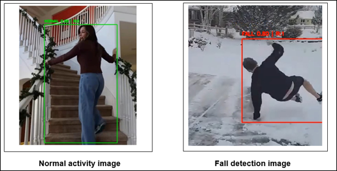

# Video-Based Human Fall Detection Using Deep Learning

A deep learning project that detects potential human falls from recorded video using YOLOv8, bounding-box geometry, motion analysis, and a multi-level risk scoring mechanism.

## Overview

Falls are a major safety concern for elderly individuals and people with mobility impairments. This project explores a camera-based fall detection system that does not require wearable sensors.

The system uses a YOLO object detection model to analyze video frames, followed by geometric and motion-based analysis to identify potential falls. A risk score ranging from 0 to 3 provides an indication of the severity of detected events.

The project was developed as part of **BCSE332L — Deep Learning** at Vellore Institute of Technology, Chennai.

## Objectives

- Develop a video-based human fall detection pipeline using deep learning.
- Create a custom dataset from publicly available YouTube videos.
- Detect people and analyze their bounding-box characteristics.
- Track vertical displacement across consecutive frames.
- Combine geometric and motion-based cues to reduce false positives.
- Assign risk levels to detected events.

## Technologies Used

- Python
- Google Colab
- Ultralytics YOLO
- OpenCV
- NumPy, if used in the notebook

## System Architecture

The project follows a three-layer architecture.

1. **Input Layer:** Recorded video is loaded and divided into frames at fixed intervals.
2. **Processing Layer:** Frames are preprocessed and analyzed by the YOLO model. Bounding-box aspect ratios and motion are then evaluated.
3. **Output Layer:** The system displays detection information, activity classification, and a risk score.

### Workflow

```text
Recorded Video
      |
      v
Frame Extraction
      |
      v
Preprocessing
      |
      v
YOLO Object Detection
      |
      v
Bounding-Box Analysis
      |
      v
Motion Analysis
      |
      v
Fall Assessment
      |
      v
Risk Score (0-3)
      |
      v
Annotated Output
```

## Dataset Description

A custom dataset was developed using publicly available YouTube video clips.

The dataset includes fall events and normal activities such as walking, sitting, bending, and lying down. Video frames were extracted and annotated using the YOLO annotation format.

**Dataset characteristics:**

- Source: YouTube video clips
- Classes: Fall and Normal
- Annotation format: YOLO
- Environments: Indoor and outdoor scenes
- Variations: Lighting conditions, camera angles, and human activities
- Preprocessing: Frame extraction, resizing, annotation, and dataset splitting

The dataset is stored separately in Google Drive and is not included in this repository.

## Model Selection and Training

We selected **YOLOv8m (Medium)** for the final fall detection system after considering YOLOv8n (Nano) as a lighter alternative.

YOLOv8n was considered because of its smaller model size and lower computational requirements. However, for our project, we chose YOLOv8m to prioritize the balance between detection performance and computational cost.

YOLOv8m was fine-tuned on our custom fall detection dataset, followed by geometric and motion-based analysis to identify potential falls.

### Training Configuration

| Parameter | Stage 1 | Stage 2 |
|---|---:|---:|
| Model | YOLOv8m | YOLOv8m |
| Epochs | 40 | 20 |
| Image size | 640 × 640 | 960 × 960 |
| Batch size | 8 | 4 |
| Learning rate | 0.001 | 0.001 |

The two-stage training strategy begins at a lower image resolution and then fine-tunes the model at a higher resolution to capture finer spatial details.

The final model is used for inference, with bounding-box geometry and motion analysis providing additional information for fall assessment.

## Fall Detection Methodology

### 1. Object Detection

Each video frame is passed through the YOLO model to identify people and obtain bounding-box coordinates and confidence scores.

### 2. Bounding-Box Aspect Ratio Analysis

The height-to-width ratio of a person's bounding box is analyzed to identify potentially horizontal postures. A low ratio can indicate a potential fall, although lying down or other normal activities can produce similar results.

### 3. Motion Analysis

The vertical position of the bounding-box center is tracked across consecutive frames. Sudden displacement can provide evidence of a potential fall.

### 4. Combined Fall Assessment

Detection confidence, bounding-box geometry, and motion information are combined to assess whether a frame or event may represent a fall.

## Risk Score Calculation

The project uses a risk score ranging from 0 to 3.

| Score | Risk Level | Interpretation |
|---:|---|---|
| 0 | No Risk | Normal activity |
| 1 | Low Risk | Minor posture deviation |
| 2 | Medium Risk | Suspicious motion or potential partial fall |
| 3 | High Risk | High-confidence fall indication |

According to the project report, the risk score uses detection confidence, bounding-box aspect ratio deviation, and vertical motion speed.

The exact thresholds and weights depend on the implementation in the notebook.

## Results and Discussion

The project report describes qualitative evaluation on a held-out test split.

The reported observations include:

- Person detection across different lighting conditions and camera angles.
- Aspect-ratio analysis as a useful geometric cue for potential falls.
- Motion analysis to help distinguish sudden falls from gradual movements.
- Higher-resolution fine-tuning intended to improve detection of distant subjects.
- Multi-level risk scoring to distinguish normal activity from potentially serious events.

The report also identifies challenges involving severe occlusion, overlapping bounding boxes, multi-person scenes, and limited dataset scale.

Numerical metrics such as accuracy, precision, recall, mAP, and inference speed should be added after verifying the actual evaluation outputs.

## Sample Detection Results

The following examples illustrate normal activity detection and fall detection using the proposed system.



## Applications

Potential applications include:

- Elderly care facilities and hospitals
- Smart-home safety monitoring
- Rehabilitation environments
- Public-space safety monitoring

These are potential applications rather than claims of validated real-world deployment.

## Limitations

- Sensitivity to camera angle and bounding-box geometry
- False positives for activities such as lying down
- Reduced reliability under severe occlusion
- Challenges with multiple people and overlapping bounding boxes
- Limited dataset scale and coverage of unusual scenarios
- The current project version uses recorded-video input

## Future Work

- Expand the dataset with more diverse fall and normal-activity examples.
- Integrate pose estimation to improve posture analysis.
- Improve multi-person tracking.
- Explore SMS or IoT-based alerts for high-risk events.
- Investigate deployment on edge devices such as Raspberry Pi and NVIDIA Jetson.

## How to Run

1. Open `fall_detection.ipynb` in Google Colab.
2. Install the required Python packages.
3. Mount Google Drive if the notebook uses Drive-based data storage.
4. Place the dataset in the expected directory structure.
5. Provide the trained model weights if they are not generated during training.
6. Run the notebook cells in order.
7. Review the detection outputs and evaluation results.

### Dataset and Model Setup

The current notebook uses paths under:

```text
/content/drive/MyDrive/fall_detection_dataset/
```

It also references trained weights at:

```text
/content/drive/MyDrive/fall_detection_dataset/best.pt
```

These paths are specific to the original Colab environment. Update them if your dataset or model weights are stored elsewhere.

The dataset and trained weights are not included in this repository by default.

## Repository Structure

```text
fall-detection-system/
├── fall_detection.ipynb
├── README.md
├── requirements.txt
└── results/
    ├── normal_activity.png
    └── fall_detection.png
```

The `results/` directory and its image files can be added when the sample outputs are ready.

## Team Members

- Deepali Banka
- Soumistha Bhuyan
- Shruti Sameeksha Pradhan


## References

1. J. Redmon et al., "You Only Look Once: Unified, Real-Time Object Detection," CVPR, 2016.
2. Ultralytics, [YOLO Documentation](https://docs.ultralytics.com/).
3. S. Zhang et al., "Vision-Based Fall Detection Using Deep Learning," IEEE Access, 2020.
4. M. Mubashir et al., "A Survey on Fall Detection: Principles and Approaches," Neurocomputing, 2013.
5. N. Noury et al., "Fall Detection — Principles and Methods," Engineering in Medicine and Biology Society, 2007.

## Disclaimer

This project was developed for academic and research purposes. Its outputs should not be treated as a substitute for professional medical assessment or a clinically validated emergency monitoring system.
